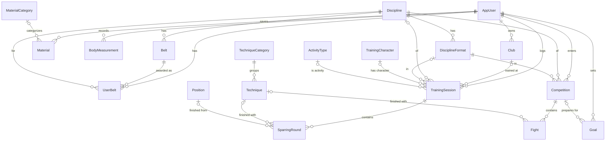

# 01. Domain model

## 1. General rules

- Primary keys: `int` identity for everything except `AppUser` (`Guid`).
- User-owned entities have `UserId` (`Guid`, FK to `AppUser`) and `CreatedAtUtc`. Base class: `UserOwnedEntity`.
- Dates: `DateOnly`. Durations: minutes (`int`) unless stated. Metric units.
- Enums are stored as **strings** in the database.
- Nullable reference types enabled. A field marked `Req = no` is nullable.
- **Isolation:** a user can never read or modify another user's data. Enforced centrally with EF Core global query filters on every entity that has a `UserId`. `SparringRound` and `Fight` are ordinary entities (own `DbSet`, no `UserId` column) reached through their parent; they get the equivalent filter through the parent navigation (for example `r.TrainingSession.UserId == currentUserId`), so a direct query is safe too and EF raises no warning. Analytics may load rounds as `Sessions.SelectMany(s => s.Rounds)`. Verified by integration tests written with each task (from T03) and completed in T20. A foreign key that points to someone else's record behaves as "not found".

## 2. ERD

## 3. Dictionaries (read-only, seeded)

All dictionary tables share: `Id`, `Code` (string 50, lower_snake_case, **stable identifier used by the seeder**), `Name` (string 100), `SortOrder` (int).

| Table | Extra fields |
|---|---|
| `Discipline` | none |
| `DisciplineFormat` | `DisciplineId` (req) |
| `TrainingCharacter` | `AllowsRounds` (bool, req): sparring rounds may be recorded in sessions of this character |
| `ActivityType` | none (for non-grappling sessions) |
| `TechniqueCategory` | none |
| `Technique` | `CategoryId` (req) |
| `Position` | none |
| `Belt` | `DisciplineId` (req), `Rank` (int, higher = more advanced), `MinDegree` and `MaxDegree` (int, req): allowed stripes / degrees for this belt |
| `MaterialCategory` | none |

Contents: `07-seed-data.md`. Unique indexes: `(Code)` on every dictionary **except** `DisciplineFormat` and `Belt`, which are unique on `(DisciplineId, Code)` (codes such as `white` or `black` repeat across disciplines). The seeder upserts by `Code`, or by `(DisciplineId, Code)` for those two tables.

## 4. User data

### 4.1 AppUser
Extends `IdentityUser<Guid>`.

| Field | Type | Req | Notes |
|---|---|---|---|
| FirstName | string(100) | no | filled on the profile page |
| LastName | string(100) | no | |

### 4.2 Club

| Field | Type | Req | Notes |
|---|---|---|---|
| Name | string(100) | yes | unique per user, case-insensitive |

### 4.3 UserBelt
One belt per discipline per user.

| Field | Type | Req | Notes |
|---|---|---|---|
| DisciplineId | int | yes | |
| BeltId | int | yes | must belong to `DisciplineId` |
| Degree | int | yes | stripes (BJJ) or dan grade (judo). Must be within the chosen belt's `MinDegree..MaxDegree` (data-driven, values in `07-seed-data.md`). Default = `MinDegree`. |

Unique `(UserId, DisciplineId)`.

### 4.4 TrainingSession

| Field | Type | Req | Notes |
|---|---|---|---|
| Date | DateOnly | yes | not more than 1 day in the future |
| Kind | enum `Grappling`, `Other` | yes | |
| DurationMinutes | int | yes | 1..600 |
| Feeling | int | yes | 1..5 (1 = bad, 5 = great) |
| Notes | string(4000) | no | |
| DisciplineId | int | Grappling only | |
| FormatId | int | Grappling only | must belong to `DisciplineId` |
| CharacterId | int | Grappling only | |
| ClubId | int | no | Grappling only. `null` = "Other club". Deleting a club that is used is blocked (409). |
| ActivityTypeId | int | Other only | |
| Rounds | list of `SparringRound` | no | Grappling only; 0..50. Must be empty unless the character has `AllowsRounds` (I-09). |

DB check constraint: `Kind = 'Grappling'` ⇒ `DisciplineId, FormatId, CharacterId` not null and `ActivityTypeId` null; `Kind = 'Other'` ⇒ `ActivityTypeId` not null and `DisciplineId, FormatId, CharacterId, ClubId` null.

Several sessions per day are allowed. Index `(UserId, Date)`.

### 4.5 SparringRound
Child of `TrainingSession` (ordinary entity, cascade delete).

| Field | Type | Req | Notes |
|---|---|---|---|
| Order | int | yes | 1..n, assigned from list order |
| Result | enum `Win`, `Loss`, `Draw` | yes | `Draw` also covers "no result" |
| TechniqueId | int | no | only if `Result` is `Win` or `Loss` (the finish) |
| PositionId | int | no | only if `TechniqueId` is set. See D-07 for perspective |
| Notes | string(500) | no | |

### 4.6 Competition

| Field | Type | Req | Notes |
|---|---|---|---|
| Name | string(150) | yes | |
| Date | DateOnly | yes | may be in the future (for preparation goals) |
| Location | string(150) | no | |
| DisciplineId | int | yes | |
| FormatId | int | yes | must belong to `DisciplineId` |
| AgeCategory | string(50) | no | free text |
| SkillLevel | string(50) | no | free text |
| WeightCategory | string(50) | no | free text |
| Place | int | no | final place, 1..1000; null while unknown. Places 1-3 are shown as gold, silver, bronze medals |
| ResultNote | string(100) | no | free text for what the number cannot say (e.g. "quarterfinal", "disqualified") |
| Notes | string(4000) | no | |
| Fights | list of `Fight` | no | 0..30 |

Index `(UserId, Date)`.

### 4.7 Fight
Child of `Competition` (ordinary entity, cascade delete).

| Field | Type | Req | Notes |
|---|---|---|---|
| Order | int | yes | 1..n |
| OpponentName | string(100) | no | |
| Result | enum `Win`, `Loss`, `Draw` | yes | `Draw` is rare (submission-only formats, friendly matches) |
| Method | enum `Submission`, `Points`, `Decision`, `Disqualification`, `Walkover` | unless `Draw` | required for `Win` / `Loss`; must be empty for `Draw` |
| TechniqueId | int | no | only if `Method = Submission` |
| DurationSeconds | int | no | 1..3600 |
| Notes | string(500) | no | |

### 4.8 Goal

| Field | Type | Req | Notes |
|---|---|---|---|
| Type | enum `TrainingCount`, `SparringRoundCount`, `CompetitionPrep`, `Manual` | yes | |
| Title | string(150) | yes | |
| Description | string(1000) | no | |
| StartDate | DateOnly | count types, prep | |
| EndDate | DateOnly | count types; optional for `Manual`; not stored for `CompetitionPrep` | for `CompetitionPrep` the competition's date is used, so the two can never diverge |
| TargetValue | int | count types | 1..10000. Optional for `CompetitionPrep` |
| CompetitionId | int | prep only | `NoAction` on delete: deleting a competition used by a goal returns 409 |
| ManualProgressPercent | int | Manual | 0..100 |
| IsArchived | bool | yes | default false |

Progress, current value, and state are **computed on read**, never stored (`03-analytics.md`, section 8).

### 4.9 Material

| Field | Type | Req | Notes |
|---|---|---|---|
| Title | string(200) | yes | |
| Url | string(500) | yes | absolute http(s) URL |
| Source | enum `YouTube`, `Instagram`, `TikTok`, `Other` | yes | **detected on the server from the URL host**; not sent by the client |
| CategoryId | int | no | `MaterialCategory` |
| Status | enum `Saved`, `Watched`, `Practiced`, `Mastered` | yes | default `Saved` |
| Notes | string(2000) | no | |

### 4.10 BodyMeasurement

| Field | Type | Req | Notes |
|---|---|---|---|
| Date | DateOnly | yes | unique per user and date |
| WeightKg | decimal(5,2) | no | 20..300 |
| HeightCm | decimal(5,1) | no | 100..250 |
| BodyFatPercent | decimal(4,1) | no | 2..60 |

At least one of the three values must be present.

## 5. Delete behavior

- Deleting a user cascades to all user-owned data (D-21). If SQL Server reports multiple cascade paths, perform an explicit ordered delete in a transaction instead.
- `TrainingSession → SparringRound` and `Competition → Fight`: cascade.
- `Session.ClubId`, `Goal.CompetitionId`: `NoAction` (the API returns `409 Conflict` with a clear message).
- Dictionary rows are never deleted.

## 6. Invariants checked by validators and tests

| ID | Rule |
|---|---|
| I-01 | `FormatId` belongs to `DisciplineId` (sessions, competitions). |
| I-02 | `UserBelt.BeltId` belongs to `UserBelt.DisciplineId`, and `Degree` is within that belt's `MinDegree..MaxDegree`. |
| I-03 | Round: `Draw` has no technique and no position; position requires a technique. |
| I-04 | Fight: technique only when `Method = Submission`. A `Draw` has no method and no technique. |
| I-05 | Every referenced `ClubId` / `CompetitionId` belongs to the current user. |
| I-06 | Goal fields required per `Type` (table in 4.8); `EndDate ≥ StartDate` where both exist; for `CompetitionPrep`, `StartDate` is not later than the competition's date. |
| I-07 | Body measurement has at least one value. |
| I-08 | No endpoint ever returns or accepts another user's data. |
| I-09 | A session may have rounds only if its character has `AllowsRounds = true`. |
